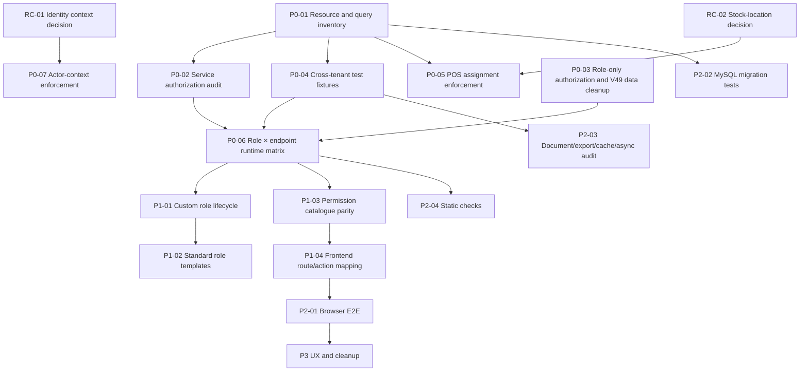

# Develop Branch Prioritized Implementation Plan — Authorization and Tenant Isolation

**Repository:** `rambrij/solar-energy-platform`  
**Base:** `develop` at `1d5c15eca4b7d870ac2eb0d0edb92732d5b7b709`  
**Working branch:** `feature/develop-authorization-gap-analysis`  
**Source of truth:** Product Requirements v2.0 and SRS/HLD v2.0  
**Plan date:** 2026-11-17

## 1. Implementation principles

1. Preserve the existing Spring Security, membership, custom-role, POS, checkout, tenant and navigation implementations.
2. Do not replace working permission names, endpoint contracts, IDs or migrations without a compatibility path.
3. Deny by default. Backend authorization remains authoritative; UI visibility is only a usability layer.
4. Derive tenant, actor, branch, register and session from trusted authentication and persisted assignment. Treat request IDs as resource selectors only, never as authority.
5. Every tenant-owned read/write must have a tenant-scoped lookup and ownership check. Use composite constraints as a second boundary.
6. Separate platform, vendor employee and global customer contexts.
7. Keep database changes additive, versioned with Flyway and tested against MySQL 8.4 clean install and supported upgrade.
8. Add negative tests before changing high-risk behavior. Authorization is role-only: do not retain or reintroduce a legacy permission store, fallback, compatibility switch, or copied per-employee legacy roles. Remove obsolete development data through a versioned migration and fail closed until explicit roles are assigned.
9. Do not implement unresolved legal/provider/identity decisions by guessing.
10. Deliver in small, reviewable commits on this feature branch. Never write directly to `develop`.

## 2. Priority summary

| Priority | Focus | Exit condition |
|---|---|---|
| P0 — Security / tenant-isolation critical | Complete authorization and ownership enforcement; branch/warehouse/register/session; cross-tenant tests; role-only permission enforcement | Every protected API/service path has a verified policy and tenant/resource scope; all critical negative tests pass on MySQL 8.4. |
| P1 — Core functional requirement | Custom role lifecycle, standard role decision, permission catalogue parity, UI action mapping | Effective permissions control every route/action and custom roles work from assignment through API and data scope. |
| P2 — Important improvement | MySQL upgrade/integration suite, browser E2E, architecture/static checks, export/document/cache/async audit | CI proves migration, tenant isolation, route denial, idempotency and architecture constraints. |
| P3 — UX / cleanup | Responsive navigation, breadcrumb/menu polish, accessibility and removal of duplicate permission state | UX is consistent without weakening backend enforcement. |

## 3. P0 — Security and tenant-isolation critical

### P0-01 — Build a canonical tenant-owned resource and query inventory

- **Requirement:** Every tenant-owned record and child record is tenant-scoped; every query, export, report, cache, object and background operation enforces ownership (SRS §§8–10, 14, 19–20).
- **Current gap:** Selected services use tenant predicates and V41 adds selected composite constraints, but complete table/repository/native-query coverage is not established.
- **Proposed implementation:** Generate an inventory from Flyway DDL and Java persistence/query code. Classify each table as GLOBAL, CUSTOMER-GLOBAL, PLATFORM or TENANT. For each tenant table record tenant_id, parent relationship, composite FK, unique key, indexes and access services. Trace every public repository method and JDBC/JPQL/native query to a tenant-scoped caller.
- **Backend changes:** Add tenant-scoped repository methods/specifications and a consistent tenant context contract. Remove or encapsulate unscoped tenant repository access. Add explicit ownership checks before returning or mutating child resources. Audit native SQL and bulk operations.
- **Frontend changes:** None for enforcement; ensure API clients never use client-selected tenant_id as authority.
- **Database/schema changes:** Add only missing tenant_id NOT NULL, UNIQUE(tenant_id,id), composite FKs, tenant-leading indexes and RESTRICT deletion constraints after data validation. Use expand/contract migrations.
- **Tests required:** MySQL 8.4 schema inventory test; same-tenant FK success; cross-tenant FK failure; Vendor A read/update/delete/search/count/export attempts against Vendor B fixtures; orphan and null tenant rejection.
- **Dependencies:** P0-02 and P0-04; current table inventory and supported schema baseline.
- **Acceptance criteria:** Every tenant-owned table is classified; every tenant access path is traceable; no cross-tenant read/write/search/export succeeds; all relevant FK constraints reject mismatches; no data is deleted during migration.

### P0-02 — Audit and enforce authorization at every service boundary

- **Requirement:** Spring Security is authoritative; every business operation requires explicit permission plus membership/resource scope (SRS §§5, 7, 20).
- **Current gap:** Controller annotations are broadly present and POS/role/checkout services have guards, but a complete audit of all public service methods, webhook handlers, event consumers, schedulers and exports is not proven.
- **Proposed implementation:** Enumerate all controllers and public application-service methods. For each method record required permission, actor context, tenant scope, resource ownership and state/assignment policy. Require an explicit guard or an explicitly documented trusted internal caller.
- **Backend changes:** Add reusable authorization guard methods or typed actor/context objects where they reduce duplication. Add service guards to unprotected entry points. Keep controller `@PreAuthorize` for early rejection and service guards for defense in depth. Ensure 403 for authenticated unauthorized operations and non-disclosing 404 for cross-tenant resource probes.
- **Frontend changes:** None required for enforcement.
- **Database/schema changes:** None unless P0-01 finds missing ownership constraints.
- **Tests required:** Service-level direct invocation without permission; controller/API 401/403 tests; internal event/job caller tests; webhook actor/provider verification tests; method-by-method authorization inventory check.
- **Dependencies:** P0-01; existing Security and permission registries.
- **Acceptance criteria:** Every public service method has an explicit policy or documented internal trust boundary; bypassing a controller cannot bypass authorization; unauthorized calls do not reach persistence or external adapters.

### P0-03 — Enforce role-only permissions; remove legacy grant storage

- **Requirement:** Effective vendor permissions come exclusively from active tenant role assignments. All-role revocation, inactive roles, disabled membership, suspended/ineligible tenant and missing roles fail closed. Tenant entitlement filtering remains authoritative (Product Requirements §2.3; SRS authorization and membership controls).
- **Implementation status (2026-11-17):** Legacy fallback code, configuration, metrics, reconciliation endpoint and legacy grant persistence have been removed from the working branch. Role-only runtime authorization and additive V49 cleanup are committed; GitHub Actions run #988 passed the complete H2 backend suite (573 tests, 0 failures), complete MySQL 8.4 backend suite (573 tests, 0 failures), and frontend tests/build. No backward-compatibility mode is retained.
- **Runtime changes:** `MembershipService.effectiveVendorPermissions()` queries only active employee-role assignments joined to active tenant roles and their permission rows. The result is a distinct union filtered by `VendorPermissionRegistry`, then filtered by `TenantEntitlementPolicy`. No role assignment produces an empty permission list. Disabled employees and inactive tenants are rejected before permission resolution.
- **Provisioning:** Initial Vendor Admin provisioning creates an explicit `vendor-admin-initial` role and assignment. Vendor-created employees require an active, delegable role and insert the employee plus role assignment in the same transaction. Invitation acceptance activates the identity already provisioned with its role. Role replacement revokes previous assignments and assigns only the selected roles. No employee reactivation workflow exists in the inspected branch; any future reactivation must create/require explicit role assignment before enabling access.
- **Data cleanup:** Released main Flyway migrations V1–V48 are not edited. The local-only V39 demo seed was updated (it is not in the production migration location), and local-only V50 now creates demo roles after RBAC schema setup. Additive main Flyway migration V49 deletes only synthetic per-employee roles created by V45 (`role_key=legacy-<created_by>`, where `created_by` is the source employee identity), deletes their assignments/permission rows, and drops `employee_permissions`. Explicit vendor roles and assignments, including `vendor-admin-initial`, are preserved. Employees whose only role came from V45 synthetic legacy migration become role-less and are intentionally denied until an administrator assigns a real vendor role. No legacy grant values are copied into replacement roles.
- **Removed components:** `PermissionGrant`, `PermissionGrantRepository`, the fallback configuration `auth.legacy-permission-fallback-enabled` / `AUTH_LEGACY_PERMISSION_FALLBACK_ENABLED`, fallback metrics/logging, legacy reconciliation service logic and `GET /api/v1/vendor/employees/permission-reconciliation`.
- **Tests:** `MembershipServiceTest` covers role-only union, no-role and all-roles-revoked fail-closed, inactive roles, unknown/platform permission filtering, disabled employee/suspended tenant and initial Vendor Admin provisioning. `PosTest` uses role-only fixtures across the POS integration suite. `V49RemoveLegacyEmployeePermissionsTest` verifies V49 removes only V45 synthetic roles and drops the old table while preserving explicit custom roles/assignments. `V50LocalDemoRoleAssignmentsTest` verifies local demo role seeding and preservation of existing role history. `VendorRoleServiceProvisioningTest` covers employee/invitation role provisioning, inactive-role rejection and cross-tenant role-ID denial. `AuthenticationServiceTest` verifies `/auth/me` returns server-calculated membership permissions. `TenantEntitlementPolicyTest` covers entitlement filtering.
- **RC-05 decision:** Resolved by the product owner instruction on 2026-11-17: this application is still in development and must not support legacy permission compatibility. Remove the old table/data and do not implement a fallback switch.
- **Verification:** GitHub Actions run #988 passed 573/573 H2 tests and 573/573 MySQL 8.4 tests, plus frontend tests and build. Both V49 cleanup and V50 local role-seed tests passed. Main V49 is an additive upgrade migration and leaves explicit role data intact. The remaining environment action is to let Flyway apply V49 in the developer database and assign explicit roles to any employees that previously depended only on V45-generated roles. A local database that already applied the older local-only V39 checksum must use a separate disposable development database; do not rewrite Flyway history or remove operational/financial data. No production reconciliation/rollback path is required because legacy compatibility is intentionally retired before production.
 
### P0-04 — Prove Vendor A/Vendor B and Customer A/Customer B isolation

- **Requirement:** Cross-tenant data and customer-owned resources are inaccessible even when IDs, filters, URLs, body fields or headers are guessed (Product Requirements §§1, 5, 10, 13; SRS §§9, 10, 20.3).
- **Implementation status (2026-11-17):** **IMPLEMENTED — VERIFICATION PENDING; NOT COMPLETE.** A dedicated P004TenantIsolationTest and reusable TenantIsolationFixture have been added on feature/develop-authorization-gap-analysis. The fixture provisions Vendor A/B employees, Customer A/B, tenant roles/permissions, tenant-owned products and stock, and Customer A's independent relationships with both vendors plus Customer B's Vendor B-only relationship.
- **Focused fixture tests:** Bidirectional role/employee list and IDOR checks; attempts to read/update/deactivate the other vendor's role; attempts to query/assign/update-branch/assign-register/disable the other vendor's employee; customer username/profile substitution and cross-actor denial; global customer relationship membership; tenant/branch/resource forgery against inventory reads/writes; database rejection of foreign product/inventory and cross-tenant role-assignment parents. Rejected mutation tests assert unchanged protected records, stock quantities and absence of resource audit writes.
- **Existing API/service evidence reused:** PosTest already exercises inventory API 401/403/non-disclosing 404 and no receipt write; order list/detail and customer list/detail scoping; Customer A's paid orders across two vendors while Customer B receives 404; mixed-vendor cart rejection and vendor switching; forged request-body/tenant filters; payment/receipt/PDF ownership; return/refund ownership; tenant-scoped report/CSV export; and platform/vendor/customer actor boundaries. CustomerAccessAuthorizationBoundaryTest, CartServiceAuthorizationBoundaryTest, CheckoutServiceAuthorizationBoundaryTest, ReadOnlyServiceAuthorizationBoundaryTest and ReturnsExportsAuthorizationBoundaryTest preserve early service-denial/no-collaborator assertions.
- **Database evidence reused:** V6 cart/item composite tenant keys; V27 tenant/customer uniqueness and order challenge ownership; V41 subscription tenant keys/FKs; V45 tenant-aware role/employee/register assignment and audit FKs; V48 preflight plus composite POS/subscription child ownership FKs. V48TenantOwnershipMigrationTest verifies invalid cross-tenant references abort preflight without deleting source rows. The new P0-04 fixture adds runtime insert attempts for inventory and role-assignment composite ownership.
- **Code/schema changes for this item:** Test-only additions: backend/src/test/java/com/saumya/pos/isolation/TenantIsolationFixture.java and backend/src/test/java/com/saumya/pos/P004TenantIsolationTest.java. No production Java, database schema, migration or frontend code was changed in this P0-04 pass; existing tenant predicates and V6/V27/V41/V45/V48 constraints were reused rather than duplicated.
- **Defects found/fixed:** No production isolation defect has yet been confirmed by an executed P0-04 test. Do not record a production fix until a failing assertion establishes the defect and a regression test passes.
- **NOT APPLICABLE (current implementation inventory):** CRM notes/leads/quotes, shipment/installation/warranty/service modules, generic object-storage signed URLs, and async/cache data-plane paths were not established as implemented resource families in the current branch review. Do not add those features as part of P0-04; re-evaluate when their APIs/storage workers exist. The implemented tenant-customer association is covered, but it is not a CRM notes API.
- **Required verification still outstanding:** Run mvn -B -f backend/pom.xml -Dtest=P004TenantIsolationTest test, the full H2 backend suite, the full MySQL 8.4 suite, and the frontend tests/build if affected. The checked-in .github/workflows/pos-tests.yml provides the H2/MySQL 8.4 matrix and frontend test/build jobs. Record exact run IDs, counts and failures after CI completes; this task remains open until both database suites pass.
- **Acceptance criteria:** Do not mark COMPLETE until Vendor A/B and Customer A/B are proven in both directions; Customer A retains own cross-vendor order access; API/service/repository/database checks pass; inaccessible counts/search/export/download do not leak; applicable MySQL 8.4 same-tenant constraints reject forged references; and rejected operations have no persisted, inventory or external side effects.

### P0-05 — Complete POS branch/register/session and warehouse authorization

- **Requirement:** POS operations require permission + tenant + branch + assigned stock location/warehouse + register + cashier + OPEN session + resource ownership (Product Requirements §9.2; SRS POS-007…POS-040 and §§14.3–14.5, 20.4).
- **Current gap:** Membership and POS context carry tenant, one branch and cashier; register assignment and session checks exist. First-class warehouse assignment is not established by reviewed code.
- **Proposed implementation:** Map the current MVP designated stock location to its authoritative server-side entity. Enforce employee/register/branch/session assignment on every POS operation and enforce warehouse/stock-location scope for inventory reads and writes. Do not introduce advanced multi-warehouse workflows without approval.
- **Backend changes:** Review `AuthorizationContext`, `MembershipService`, `VendorRoleService`, `PosService`, `CheckoutService`, tender/return/refund/receipt/report services. Resolve session and register from trusted context. Recheck OPEN state under transaction/row lock. Validate assignment after branch or role changes.
- **Frontend changes:** Use server-returned active session and assigned register/branch; display denial and recovery states without trusting sessionStorage as authority.
- **Database/schema changes:** Add same-tenant composite keys/FKs for branch, register, session, cashier and approved stock location if missing; enforce one OPEN/CLOSING session per till; preserve closed session immutability.
- **Tests required:** Forged tenant/branch/cashier/session/register/warehouse IDs; wrong branch; unassigned register; closed session; revoked assignment during active session; cashier A reading cashier B drawer; concurrent session open; cross-tenant session/order relation; inventory wrong stock location.
- **Dependencies:** RC-02 and RC-04; P0-01.
- **Acceptance criteria:** Every POS command is bound to one authenticated employee, active tenant, assigned branch/register, valid OPEN session and approved stock location; client IDs never override server context.

### P0-06 — Add a true Role × Endpoint runtime authorization matrix

- **Requirement:** Every endpoint has a permission policy and unauthorized API mutations return 403; VIEW never implies mutation (SRS §§11, 15, 20.3).
- **Current gap:** `AuthorizationPolicyMatrixTest` evaluates method-security expressions and checks every mapped endpoint, but it does not execute every API endpoint with persisted effective roles, tenant and resource fixtures.
- **Proposed implementation:** Keep the static policy test; add parameterized MockMvc/API integration tests generated from a canonical endpoint policy matrix. Include platform, vendor admin, custom role, cashier, accountant, customer, support and anonymous contexts.
- **Backend changes:** Maintain a canonical operation matrix with endpoint, HTTP method, required permissions, actor type, tenant scope and assignment requirement. Add tests for every controller method and service operation.
- **Frontend changes:** Consume the same permission catalogue/metadata where feasible; do not duplicate business authorization logic in components.
- **Database/schema changes:** Test role/assignment migrations and effective permissions against MySQL.
- **Tests required:** Every endpoint with missing permission; VIEW-only versus CREATE/UPDATE/DELETE/APPROVE/REFUND; platform/vendor/customer wrong actor; custom role allowed/denied; branch/session wrong assignment; 401/403/404/409 semantics.
- **Dependencies:** P0-02, P0-03, P0-05.
- **Acceptance criteria:** No mapped endpoint is absent from the matrix; all mutation endpoints deny VIEW-only grants; all positive and negative runtime cases pass on MySQL 8.4.

### P0-07 — Define and enforce actor-context separation

- **Requirement:** Platform, vendor employee and global customer permissions remain separate; a global customer identity never grants employee access.
- **Current gap:** Platform identity is explicitly separated. A non-platform user can be resolved as both CUSTOMER and vendor member, while `AuthorizationContext.requireVendorMembership()` rejects customer context. Product policy does not explicitly settle this dual-context case.
- **Proposed implementation:** Obtain RC-01 decision. If dual identities are allowed, model an explicit server-validated active actor context and separate claims/session selection. If prohibited, enforce uniqueness/policy during provisioning and document migration behavior.
- **Backend changes:** Make context resolution explicit; never infer vendor authority from customer claims or vice versa. Ensure platform support remains a separately audited privileged path.
- **Frontend changes:** Provide explicit context selection only if product approves; avoid mixed navigation.
- **Database/schema changes:** Only if approved identity-context model requires a membership/context relation.
- **Tests required:** Customer-only; vendor-only; platform-only; dual customer/vendor; attempted platform/vendor overlap; token refresh after context switch; revoked membership.
- **Dependencies:** Product decision RC-01; P0-02.
- **Acceptance criteria:** Each request has one unambiguous actor scope; customer access cannot invoke vendor services; vendor membership cannot expose global CRM history; platform identity never inherits commercial vendor authority.

## 4. P1 — Core functional requirements

### P1-01 — Complete custom-role lifecycle and delegation tests

- **Requirement:** Custom vendor roles are tenant-scoped, versioned, delegable only within the acting admin's grants, and effective immediately after assignment.
- **Current gap:** Role create/update/deactivate, role assignment, branch/register assignment and delegation checks exist; complete lifecycle and multi-tenant runtime coverage is not proven.
- **Proposed implementation:** Preserve the existing service and add integration coverage; fix only demonstrated defects.
- **Backend changes:** Add tests for role CRUD, permission replacement, optimistic version conflicts, assignment replacement, revocation, disabled employees, branch changes and audit records.
- **Frontend changes:** Verify role editor displays only server-approved vendor permissions and does not expose PLATFORM_*.
- **Database/schema changes:** No change expected unless constraints or audit evidence are missing.
- **Tests required:** Role A cannot be viewed/changed by Vendor B; actor cannot delegate permission it lacks; role deactivation removes effective permissions; all-role removal denies; stale version returns conflict.
- **Dependencies:** P0-03, P0-06.
- **Acceptance criteria:** Custom role changes affect subsequent authorization; no platform permission can be granted; delegation is no more powerful than the acting administrator.

### P1-02 — Resolve standard role templates

- **Requirement:** SRS §11.1 standard roles are provisioned or their illustrative status is confirmed.
- **Current gap:** Initial Vendor Admin and custom roles are evidenced; complete standard role template seed set is not.
- **Proposed implementation:** Resolve RC-03. If required, add tenant-scoped least-privilege role templates from the approved matrix; templates are not global privilege bypasses.
- **Backend changes:** Add seed/template service and safe clone-on-first-use behavior only if approved.
- **Frontend changes:** Offer approved templates as starting points; display exact permission grants.
- **Database/schema changes:** Optional template/version metadata, with tenant-scoped role assignment.
- **Tests required:** Template grants match role matrix; custom clone cannot escalate; templates update safely without mutating existing tenant roles.
- **Dependencies:** P1-01, RC-03.
- **Acceptance criteria:** Every advertised standard role maps to explicit permission grants and tests; no role is silently assigned extra authority.

### P1-03 — Align permission catalogue with approved feature scope

- **Requirement:** SRS/Product Requirements permission IDs, backend allow-lists, database checks, frontend routes and endpoint policies remain consistent.
- **Current gap:** Registry validation exists, but complete SRS-to-runtime parity and later CRM/Operations permission families are not established.
- **Proposed implementation:** Create a generated comparison report and trace every permission to endpoint, service, UI action and test. Do not add permissions for unimplemented features.
- **Backend changes:** Normalize permission IDs and centralize allow-list source; retain aliases only with migration compatibility.
- **Frontend changes:** Reference canonical route/action policies; remove dead or misleading navigation entries.
- **Database/schema changes:** Expand DB permission CHECK constraints additively when approved new permission IDs are introduced.
- **Tests required:** Registry parity; unknown permission rejected; PLATFORM_* vendor grant rejected; every permission has at least one mapped endpoint/action or is documented as reserved.
- **Dependencies:** P0-06, P1-01.
- **Acceptance criteria:** No unknown, orphaned or conflicting permission ID; all grants trace to an approved operation.

### P1-04 — Complete frontend page, tab and operation permission mapping

- **Requirement:** Menus, submenus, pages, tabs and buttons reflect effective permissions; backend independently enforces each operation.
- **Current gap:** `Shell.tsx` filters navigation and `App.tsx` gates selected actions; full mapping across all features is not established.
- **Proposed implementation:** Define per-page and per-action permission metadata tied to canonical endpoint operations. Distinguish view permission from mutation permission.
- **Backend changes:** None unless P0-02/P0-06 finds missing guards.
- **Frontend changes:** Gate every action, tab and nested page; handle 403 without losing pending user data; keep route guard separate from operation guards.
- **Database/schema changes:** None.
- **Tests required:** Component tests for each action; route tests for each deep link; permission change/expiry tests; unauthorized API remains denied even when UI is manipulated.
- **Dependencies:** P0-06 and P1-03.
- **Acceptance criteria:** No button or tab is visible/enabled without its exact effective permission; direct URLs are denied; backend 403 remains authoritative.

## 5. P2 — Important quality and verification improvements

### P2-01 — Add browser E2E coverage for routes and role journeys

- **Requirement:** Playwright coverage for vendor workspace, platform workspace, customer portal and POS journeys.
- **Current gap:** Frontend package uses Vitest/Testing Library; no Playwright dependency or browser E2E workflow is present in the inspected package.
- **Proposed implementation:** Add Playwright and deterministic multi-role test fixtures, or document an approved equivalent.
- **Backend changes:** Provide stable test seed/setup and test-only authentication fixtures without production bypass.
- **Frontend changes:** Test mobile navigation, direct URLs, hidden actions, route refresh, browser history and session expiry.
- **Database/schema changes:** Test fixture seed only.
- **Tests required:** Vendor Admin, custom Sales role, cashier, accountant, platform admin, customer; direct route denial; action 403; cross-tenant browsing.
- **Dependencies:** P0-04, P0-06, P1-04.
- **Acceptance criteria:** E2E suite runs in CI and proves both allowed and denied journeys.

### P2-02 — Strengthen MySQL migration and persistence integration tests

- **Requirement:** MySQL 8.4 clean install, upgrade and tenant constraints validated on every release.
- **Current gap:** CI has H2/MySQL matrix but current test dependencies do not declare Testcontainers or REST Assured.
- **Proposed implementation:** Standardize MySQL integration tests using the existing CI service or adopt Testcontainers. Add schema migration upgrade fixtures.
- **Backend changes:** Add test profiles and DB-backed repository/API tests.
- **Frontend changes:** None.
- **Database/schema changes:** Migration corrections discovered by clean-install/upgrade tests.
- **Tests required:** All Flyway versions; V40–V47 role/tenant constraints; MySQL composite FKs/checks/generated columns; concurrency and transaction rollback.
- **Dependencies:** P0-01, P0-04, P0-05.
- **Acceptance criteria:** H2 and MySQL suites pass; supported upgrade baseline passes; CI blocks on migration or ownership regression.

### P2-03 — Audit documents, exports, caches and asynchronous work

- **Requirement:** Object keys, signed downloads, Redis keys, scheduled jobs, events and exports preserve tenant ownership and re-authorize access (SRS §§8, 20).
- **Current gap:** Document/export modules and storage/notification designs exist, but complete end-to-end tenant-scope evidence is not established.
- **Proposed implementation:** Create a data-flow inventory from request to storage/queue/cache and back. Require tenant ID in internal event/job envelopes, but revalidate membership and ownership at execution.
- **Backend changes:** Add authorization checks at export generation/download, signed URL issuance, background worker and cache access boundaries.
- **Frontend changes:** Handle expired download links and 403/404 safely.
- **Database/schema changes:** Add ownership columns/indexes only if missing.
- **Tests required:** Cross-tenant export/document ID; signed URL owner mismatch; tenant context cleanup after exception/thread reuse; job with forged/absent tenant; cache-key collision tests.
- **Dependencies:** P0-01, P0-04.
- **Acceptance criteria:** No background, cache or document path can widen access beyond the authenticated owner/tenant.

### P2-04 — Expand architecture and static authorization checks

- **Requirement:** Module boundaries and authorization registry remain enforced in CI.
- **Current gap:** ArchUnit and registry scripts exist but cover selected rules and inventory parity.
- **Proposed implementation:** Extend static rules to every module and check each controller policy against canonical permission metadata. Keep runtime tests as the source of behavioral proof.
- **Backend changes:** ArchUnit rules for repository ownership, controller/service boundary and public module APIs.
- **Frontend changes:** Registry script validates route and action metadata, not only route IDs.
- **Database/schema changes:** None.
- **Tests required:** Mutation tests proving CI fails on missing policy, unknown permission, cross-module internal import and unscoped repository.
- **Dependencies:** P0-02, P0-06, P1-03.
- **Acceptance criteria:** CI detects policy drift and architectural bypasses before merge.

## 6. P3 — UX and cleanup

### P3-01 — Refine responsive navigation and active location

- **Requirement:** Grouped sidebar, dropdown, tabs, breadcrumbs, active menu state and mobile hamburger navigation.
- **Current gap:** `Shell.tsx` already implements grouped navigation, quick jump, breadcrumbs, active marker and a menu toggle; responsive and accessibility proof is incomplete.
- **Proposed implementation:** Preserve existing shell and improve only verified gaps.
- **Backend changes:** None.
- **Frontend changes:** Improve responsive layout, focus management, keyboard interaction, tab order, aria labels and breadcrumb hierarchy.
- **Database/schema changes:** None.
- **Tests required:** Viewport snapshots, keyboard navigation, screen-reader semantics and permission-filtered navigation.
- **Dependencies:** P1-04, P2-01.
- **Acceptance criteria:** Responsive navigation is usable at supported breakpoints and never renders unauthorized routes.

### P3-02 — Consolidate frontend permission state

- **Requirement:** A single consistent server-derived effective permission context drives menus, routes and actions.
- **Current gap:** Session state and `usePermissions()` both retrieve/hold permission data; duplicated resolution can drift or issue repeated requests.
- **Proposed implementation:** Consolidate permission access around the authenticated session snapshot or a shared query cache, while preserving server refresh and revocation semantics.
- **Backend changes:** Keep `/auth/me` as the authoritative effective-permission source.
- **Frontend changes:** Remove duplicated fetch paths only after tests prove no stale permission window; fail closed while loading/errors.
- **Database/schema changes:** None.
- **Tests required:** Refresh, revoked role, disabled membership, expired tenant entitlement and API 403.
- **Dependencies:** P1-04, P2-01.
- **Acceptance criteria:** One consistent permission snapshot is used; loading/error states deny protected content; server remains authoritative.

## 7. Dependency sequence

## 8. Permission model and data lifecycle controls

- Vendor permissions are sourced only from active tenant role assignments and active role permission rows.
- Do not reintroduce `employee_permissions`, `PermissionGrant`, legacy permission fallback, compatibility switches or per-employee grant copying.
- V49 removes the obsolete development-stage permission table and V45 synthetic copied roles. Employees without an explicit role remain denied until a tenant administrator assigns one.
- Do not rename permission IDs or alter unrelated route paths, receipt/order identifiers, API payload shapes or database keys as part of authorization cleanup.
- Keep existing POS draft/idempotency/session recovery semantics intact.
## 9. Delivery and verification checklist

- [ ] Both Version 2.0 source documents remain unchanged and authoritative.
- [ ] Branch is based on the reviewed develop commit; no direct develop changes.
- [ ] Every P0 item has tests before high-risk implementation.
- [ ] Every new/changed endpoint has controller and service authorization.
- [ ] Every tenant-owned lookup includes tenant/customer ownership.
- [ ] Every POS operation checks assignment and session state.
- [ ] Role × endpoint matrix includes missing-grant negative cases.
- [ ] Cross-tenant and cross-customer negative cases run on MySQL 8.4.
- [ ] Flyway clean-install and supported-upgrade tests pass.
- [ ] Frontend route/action tests and browser E2E pass.
- [ ] Existing POS, checkout, refund, receipt, inventory and subscription behavior remains covered.
- [ ] CI passes on backend H2/MySQL and frontend test/build jobs.
- [ ] No mock provider is enabled in production.
- [ ] Remaining clarification items are explicitly recorded and excluded from implementation until approved.

## 10. Required product/security decisions

See the companion gap analysis section **REQUIRES CLARIFICATION register** for RC-01 through RC-07. Implementation work depending on those decisions must not silently invent a policy.
